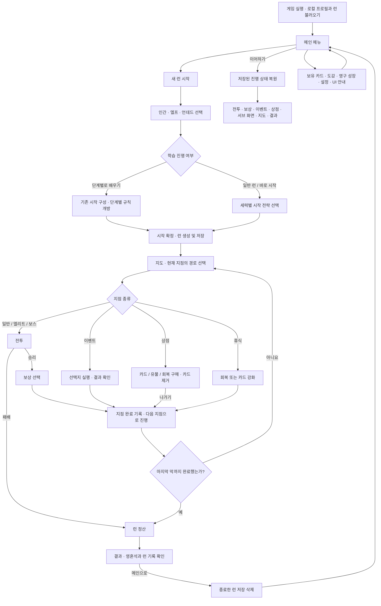
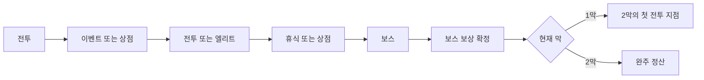
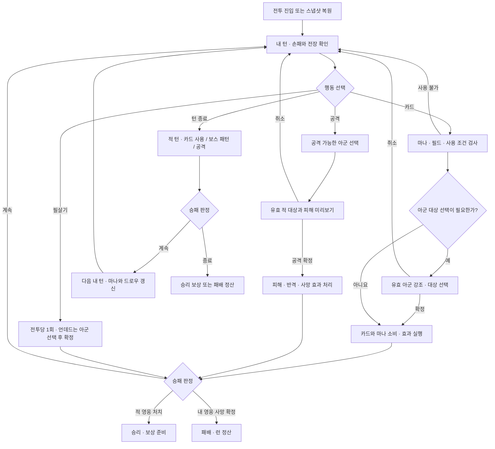
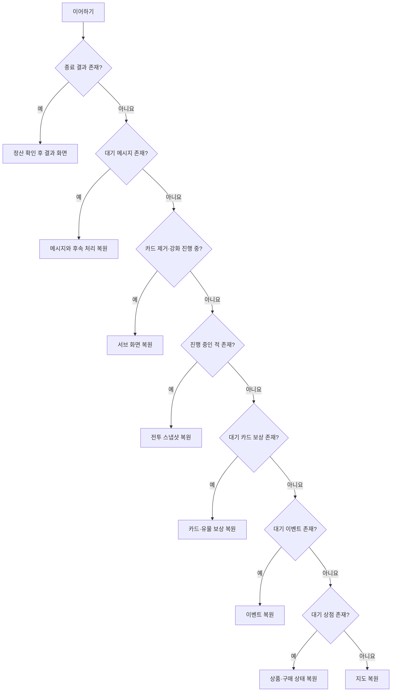

# Card Draft 서비스 흐름도

현재 코드 기준으로 사용자 화면 이동, 전투, 보상, 저장 복원을 정리한다. 아래 Mermaid 흐름도는 GitHub에서 볼 수 있다. 구현 확인 기준은 2026-10-12이며, 이 문서는 신규 기능 제안이나 실제 사용자 플레이 검증 결과가 아니다.

## 1. 전체 사용자 흐름

- 세력이나 전략을 고르는 것만으로 런을 생성하지 않는다. 시작 확정 때 구성과 진행 상태를 저장한다.
- 잘못된 전략 ID나 다른 세력의 전략은 시작 전에 거부한다. 학습 런은 일반 전략 구성을 적용하지 않는다.
- 위 보상 경로에는 예외가 있다. **첫 학습 전투는 일반 카드 보상을 생략**하고 지도 다음 지점의 장비 선택으로 진행한다.
- 이벤트는 효과에 따라 카드 보상이나 카드 제거·강화 화면을 거친 뒤 지점을 완료할 수 있다.
- 보유 카드 등의 복귀 동선은 진입 맥락에 따라 달라진다. 진행 중인 런이 있으면 이어하기로 저장된 진행 화면에 복귀한다.

## 2. 한 런의 진행

일반 새 런은 2막, 총 10개 지점이다. 각 지점에서는 제시된 경로 중 하나를 선택한다.

학습 런의 1막은 아래 순서로 고정한다. 완료한 학습 단계는 프로필에 기록한다.

| 단계 | 지점 | 배우는 행동 |
| --- | --- | --- |
| 1 | 첫 전투 | 카드 소환 → 아군 선택 → 적 선봉 공격 → 적 영웅 공격 |
| 2 | 장비 보상 | 장비를 확인하고 선택 |
| 3 | 두 번째 전투 | 아군에게 장비 사용 · 소환 2연계 |
| 4 | 휴식 | 회복 또는 카드 강화 |
| 5 | 보스 | 세력 필살기 · 3연계 피니시 |

보스 진입 단계에서 보류한 시작 카드를 개방하고, 보스 보상 이후 시작 유물과 일반 진행을 개방한다. 첫 전투의 도움은 위치와 설명만 제공하며 행동을 대신 실행하지 않는다. 기존 저장의 지도 길이·덱·유물은 그대로 복원한다.

## 3. 전투 조작과 턴 흐름

- 적 선봉이 살아 있으면 일반 유닛의 적 영웅 직접 공격을 막는다. 공격 예고와 미리보기는 현재 상태 기준이며, 아직 사용하지 않은 카드 효과까지 확정하지 않는다.
- 대상 확정 전에는 카드·마나·필살기를 소비하지 않는다. 선택 취소와 실제 효과 실행을 구분한다.
- 전투의 카드 사용과 공격은 별도의 고정 단계로 나누지 않으며, 가능한 행동의 순서를 사용자가 정한다.
- 시간 제한은 없다. 다만 현재 구현은 **행동이 모두 소진되고 선택·상세 보기 등이 없는 경우 자동 턴 종료**를 수행한다. 첫 학습 전투는 이 자동 종료 대상에서 제외한다.
- 영구 성장의 ‘두 번째 기회’가 활성이고 해당 전투에서 미사용이면 체력 0 이하에서 체력 1로 생존한 뒤 전투를 계속한다.
- 모바일 가로는 카드 탭 사용·길게 눌러 상세 확인, 세로는 첫 탭 선택·다음 탭 사용 방식이다. 스크롤로 판정된 입력은 카드 사용으로 처리하지 않는다.

## 4. 보상과 비전투 지점

| 화면 | 사용자 선택 | 확정 후 처리 | 다음 화면 |
| --- | --- | --- | --- |
| 일반 전투 보상 | 주력 강화 / 보조 연계 / 자유 후보 중 카드 선택 또는 건너뛰기 | 카드 추가 여부 확정 · 지점 완료 | 지도 |
| 엘리트·보스 보상 | 유물 후보 중 선택 + 카드 선택 또는 카드만 건너뛰기 | 선택 유물 획득 · 카드 처리 · 지점 완료 | 지도 또는 최종 결과 |
| 학습 장비 보상 | 장비 선택 또는 추천 장비 받기 | 장비 추가 · 다음 전투 준비 | 지도 |
| 이벤트 | 제시된 선택지 | 체력·골드·카드·유물 변경 또는 서브 화면 이동 | 결과 메시지 / 카드 보상 / 제거·강화 / 지도 |
| 상점 | 카드·유물·회복 구매 또는 카드 제거 | 구매마다 자원과 상품 상태 저장 · 여러 행동 가능 | 상점 유지, 나가기 때 지도 |
| 휴식 | 최대 체력의 45% 회복 또는 카드 강화 | 선택한 효과 적용 · 지점 완료 | 지도 |
| 카드 제거·강화 | 대상 카드 확정 또는 취소 | 진입 출처에 따라 비용·효과와 복귀 처리 | 상점 / 이벤트 / 휴식 등 |

전투 골드는 승리 처리에서 지급한다. 카드 보상 화면을 다시 열어 골드를 재지급하지 않는다. 보스 카드 후보는 처치한 보스 카드와 일반 후보로 구성한다. 유물 후보가 있으면 유물 선택을 완료해야 보상을 확정할 수 있으며, 카드를 건너뛰어도 선택 유물은 받는다.

## 5. 저장과 이어하기

`run_state.json`은 현재 런, `meta_profile.json`은 영혼석·영구 성장·학습 진도·설정·정산 기록 등 프로필을 담는다. 기본 경로는 Godot의 `user://`이다.

이어하기는 저장된 조건을 다음 순서로 검사한다. 단순히 마지막 화면 이름만 다시 여는 방식이 아니다.

전투는 손패·필드·체력·마나·턴·적 행동 진행 상태 등을 복원한다. 미확정 대상 선택은 복원하지 않는다. 휴식 화면 자체에는 별도 대기 상태가 없어, 강화 서브 화면 등에 진입하지 않았다면 지도에서 해당 지점에 다시 들어간다.

## 6. 종료와 반복 플레이

- **패배:** 완료한 일반전 5개, 엘리트 15개, 보스 30개의 영혼석을 합산한다.
- **완주:** 위 합계에 영혼석 100개를 추가한다. 마지막 보스의 보상까지 확정하고 정산한다.
- **중복 방지:** 프로필의 `settled_run_ids`에 런 ID별 정산액을 기록한다. 결과 재진입 시 이미 지급한 보상을 다시 지급하지 않는다.
- **결과에서 메인 복귀:** 현재 런 저장을 삭제하고 프로필 기록은 유지한다.
- **메뉴로 이동:** 런을 유지하며 이어하기가 가능하다.
- **런 포기:** 현재 구현은 런을 삭제하고 메인으로 돌아간다. 패배 정산을 호출하지 않으므로 완료 지점 영혼석도 지급하지 않는다.
- **다음 런:** 영구 성장과 학습 진도를 반영하고, 세력·전략을 새로 선택한다. 10~15분은 목표 플레이 시간이며 이 문서에서 실측 달성을 주장하지 않는다.

## 7. 구현 근거와 확인 범위

| 책임 | 코드 |
| --- | --- |
| 런 생성 · 화면 분기 · 이어하기 · 지점 완료 | `src/core/run_flow_coordinator.gd` |
| 정산 · 영구 성장 · 메인 메뉴 · 저장 호출 | `src/core/main.gd` |
| 지도 진행과 완료 지점 기록 | `src/services/run_state.gd` |
| 전투 조작 · 승패 · 보상 생성 · 자동 턴 종료 | `src/ui/screens/battle_screen.gd` |
| 카드·유물 선택과 보상 확정 | `src/ui/screens/reward_screen.gd` |
| 이벤트와 상점 효과 | `src/services/event_run_service.gd`, `src/services/shop_run_service.gd` |

문서 작성 시 위 코드를 읽고 화면 분기와 처리 순서를 대조했다. 이번 작업은 문서 추가이며 게임 실행·회귀 테스트·실물 휴대폰 검증은 새로 수행하지 않았다. 실제 입력 검증 방법은 [실행과 테스트](run-and-test.md), 학습 목표는 [첫판 경험](first-play-experience.md), 터치 동작은 [모바일 조작](mobile-controls.md)을 참고한다.
